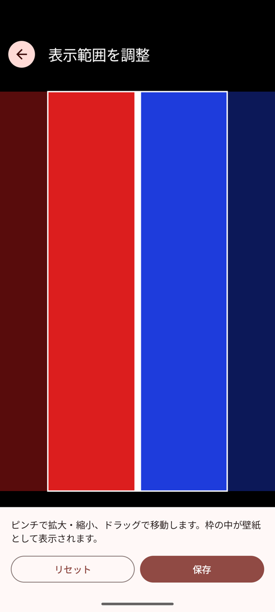
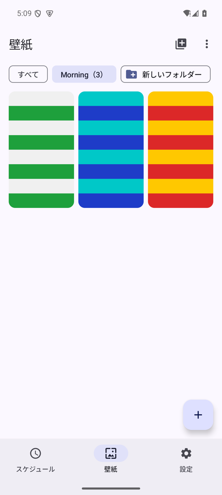
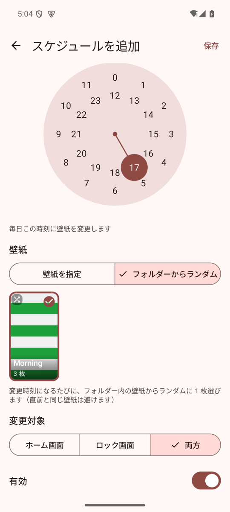

# Wallpaper Scheduler

指定した時刻に Android 端末の壁紙を自動で切り替えるアプリです。
壁紙と時刻を登録しておくと、アプリを閉じていても毎日その時刻に壁紙が変わります。

## スクリーンショット

| スケジュール一覧 | スケジュール編集 | 壁紙一覧 |
|:---:|:---:|:---:|
|  |  |  |
| 次回の変更予定と登録済みスケジュール。スイッチで有効・無効を切り替え | 時刻・壁紙・変更対象（ホーム／ロック／両方）を設定 | 端末内の画像を写真選択ツールから追加 |

| プレビュー | 表示範囲の調整 | 設定 |
|:---:|:---:|:---:|
|  |  |  |
| 全画面で確認し、その場で手動適用・削除 | 画面と同じ比率の枠で、壁紙として表示する範囲を選択 | 自動変更の ON/OFF と権限の状態 |

| フォルダー | フォルダーからランダム |
|:---:|:---:|
|  |  |
| 壁紙をフォルダーにまとめる。1 枚を複数のフォルダーに入れることも可能 | スケジュールでフォルダーを指定すると、変更時刻ごとにランダムに 1 枚選択 |

## 主な機能

- 端末内の画像を壁紙として登録・プレビュー・削除
- 壁紙として表示する範囲を、ピンチで拡大・ドラッグで移動して選択（画面の縦横比に合わせた枠で指定）
- 毎日決まった時刻に壁紙を自動変更（複数スケジュール対応）
- 壁紙をフォルダーにまとめ、スケジュールでフォルダーを指定すると変更時刻ごとにその中からランダムに選択（直前と同じ壁紙は避ける）
- 変更対象をホーム画面・ロック画面・両方から選択
- スケジュールの追加・編集・削除・有効/無効の切り替え
- 登録した壁紙をいつでも手動で適用（スケジュールはそのまま）
- 端末の再起動、時刻・タイムゾーンの変更後もスケジュールを維持し、現在の時間帯の壁紙を復元
- インターネット接続不要。画像と設定は端末内にのみ保存

## 動作環境

- Android 8.0（API 26）以上
- ライブ壁紙には対応していません

## ビルド

JDK 17 と Android SDK（API 35）が必要です。Android Studio でプロジェクトを開くか、コマンドラインで次を実行します。

```sh
./gradlew assembleDebug        # app/build/outputs/apk/debug/app-debug.apk を生成
./gradlew testDebugUnitTest    # ユニットテスト
./gradlew lintDebug            # Android Lint
```

コマンドラインでビルドする場合は、`local.properties` に `sdk.dir=<Android SDK のパス>` を記述するか、環境変数 `ANDROID_HOME` を設定してください。

## 権限

| 権限 | 用途 |
|---|---|
| `SET_WALLPAPER` | 壁紙を変更する |
| `RECEIVE_BOOT_COMPLETED` | 再起動後にスケジュールを再設定する |
| `SCHEDULE_EXACT_ALARM` | 指定時刻ちょうどに実行する（Android 12 以降はユーザーの許可が必要。未許可でも動作するが遅延しうる） |

画像の選択には Android の写真選択ツールを使うため、ストレージの読み取り権限は不要です。

## 仕組み

- 常駐サービスは使わず、`AlarmManager` に「次に実行すべき時刻」のアラームを 1 つだけ登録します。アラーム発火時にだけプロセスが起動して壁紙を変更し、次のアラームを登録します。
- 壁紙の変更に失敗しても以降のスケジュールに影響しないよう、変更より先に次回のアラームを登録します。
- OS の都合でアラームが遅れた場合は、遅延の間に過ぎた予定も含めて、変更対象ごとに最新の壁紙を適用します。
- 再起動・時刻変更・タイムゾーン変更時は、アラームを登録し直したうえで現在の時間帯の壁紙を復元します。フォルダー指定の場合、現在の壁紙がすでにそのフォルダー内のものなら選び直しません。
- フォルダーからのランダム選択では、最後に適用した壁紙（手動適用を含む）を候補から外します。フォルダー内が 1 枚だけの場合はその壁紙を使い、空の場合は変更しません。ホーム画面とロック画面の両方が対象のスケジュールでは、両方に同じ壁紙を設定します。
- 表示範囲は元画像に対する割合（0〜1）で保存し、壁紙を設定する際にその範囲だけを切り出して `WallpaperManager` に渡します。写真の EXIF の向きも反映します。範囲を指定していない壁紙は、OS が中央を基準に画面いっぱいに表示します。
- 「アラームとリマインダー」が許可されていれば `setExactAndAllowWhileIdle`、未許可なら `setAndAllowWhileIdle` を使います。

## 制約・既知の挙動

- Android の省電力機能（Doze など）や端末メーカー独自の制限により、指定時刻から変更が遅れる場合があります。「アラームとリマインダー」の許可と、電池の最適化の対象外への設定で軽減できます。
- 一部の端末では、ホーム画面のみを変更するとロック画面も同じ壁紙に変わることがあります。
- 表示範囲の枠は、範囲を選んだ時点の画面の縦横比で決まります。折りたたみ端末のように画面ごとに比率が異なる場合は、範囲を選んだ画面の比率に合わせて切り出します。
- UI は日本語のみです。端末の言語設定に関わらず日本語の字形で表示します。

## プロジェクト構成

```
app/src/main/java/com/keleveni/wallpaperscheduler/
├── WallpaperSchedulerApp.kt   # Application と依存関係（AppContainer）
├── data/                      # Room（壁紙・フォルダー・スケジュール）、DataStore（設定）、リポジトリ
├── schedule/                  # 実行時刻の計算、ランダム選択、アラーム登録、BroadcastReceiver
├── wallpaper/                 # WallpaperManager による壁紙の適用
└── ui/                        # Jetpack Compose の画面と ViewModel
```

技術スタック: Kotlin / Jetpack Compose（Material 3） / Navigation Compose / Room / DataStore / Coil
