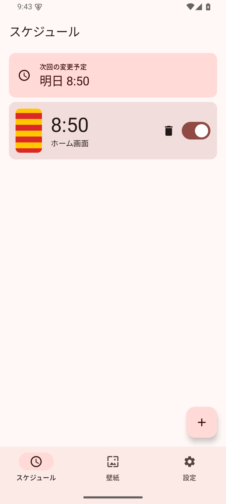
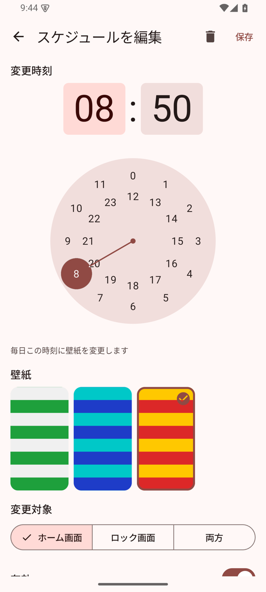
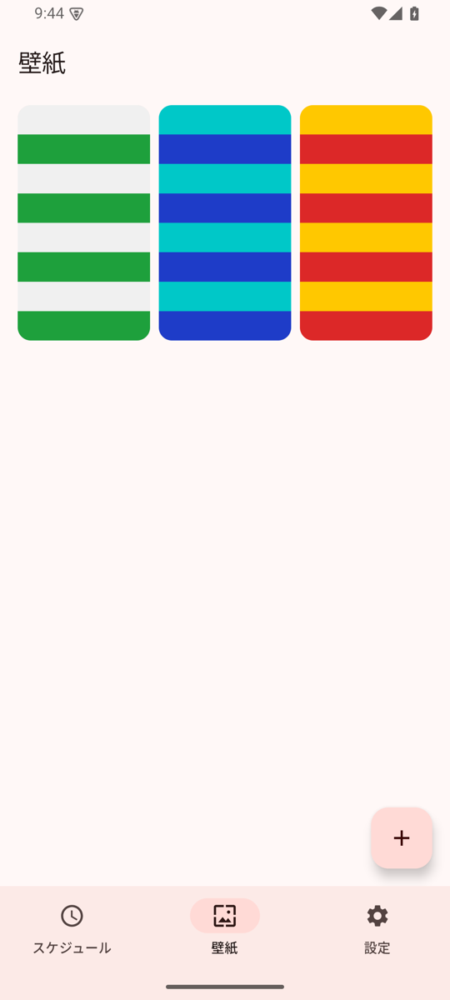
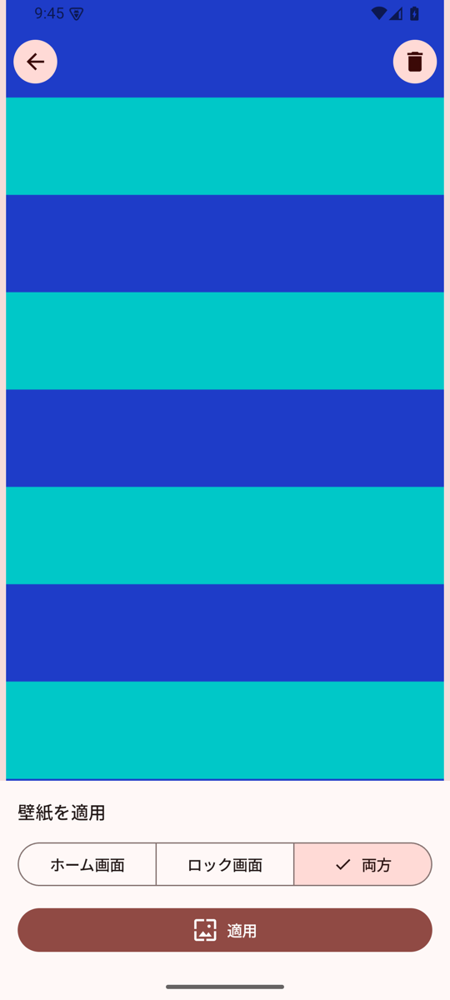
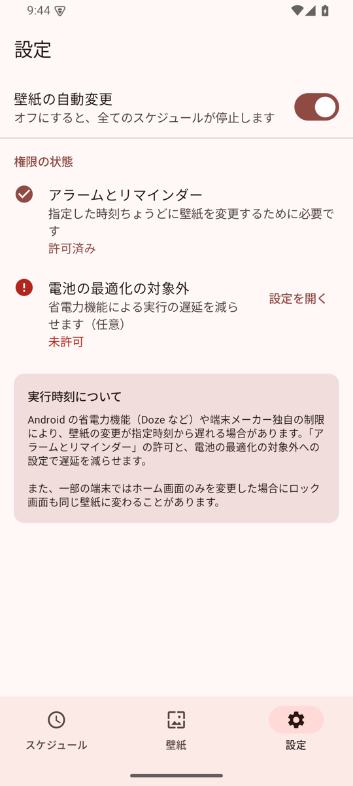

# Wallpaper Scheduler

指定した時刻に Android 端末の壁紙を自動で切り替えるアプリです。
壁紙と時刻を登録しておくと、アプリを閉じていても毎日その時刻に壁紙が変わります。

## スクリーンショット

| スケジュール一覧 | スケジュール編集 | 壁紙一覧 | プレビュー | 設定 |
|:---:|:---:|:---:|:---:|:---:|
|  |  |  |  |  |
| 次回の変更予定と登録済みスケジュール。スイッチで有効・無効を切り替え | 時刻・壁紙・変更対象（ホーム／ロック／両方）を設定 | 端末内の画像を写真選択ツールから追加 | 全画面で確認し、その場で手動適用・削除 | 自動変更の ON/OFF と権限の状態 |

## 主な機能

- 端末内の画像を壁紙として登録・プレビュー・削除
- 毎日決まった時刻に壁紙を自動変更（複数スケジュール対応）
- 変更対象をホーム画面・ロック画面・両方から選択
- スケジュールの追加・編集・削除・有効/無効の切り替え
- 登録した壁紙をいつでも手動で適用（スケジュールはそのまま）
- 端末の再起動、時刻・タイムゾーンの変更後もスケジュールを維持し、現在の時間帯の壁紙を復元
- インターネット接続不要。画像と設定は端末内にのみ保存

## 動作環境

- Android 8.0（API 26）以上
- ライブ壁紙には対応していません

## ビルド

JDK 17 と Android SDK（API 35）が必要です。Android Studio でプロジェクトを開くか、コマンドラインで次を実行します。

```sh
./gradlew assembleDebug        # app/build/outputs/apk/debug/app-debug.apk を生成
./gradlew testDebugUnitTest    # ユニットテスト
./gradlew lintDebug            # Android Lint
```

コマンドラインでビルドする場合は、`local.properties` に `sdk.dir=<Android SDK のパス>` を記述するか、環境変数 `ANDROID_HOME` を設定してください。

## 権限

| 権限 | 用途 |
|---|---|
| `SET_WALLPAPER` | 壁紙を変更する |
| `RECEIVE_BOOT_COMPLETED` | 再起動後にスケジュールを再設定する |
| `SCHEDULE_EXACT_ALARM` | 指定時刻ちょうどに実行する（Android 12 以降はユーザーの許可が必要。未許可でも動作するが遅延しうる） |

画像の選択には Android の写真選択ツールを使うため、ストレージの読み取り権限は不要です。

## 仕組み

- 常駐サービスは使わず、`AlarmManager` に「次に実行すべき時刻」のアラームを 1 つだけ登録します。アラーム発火時にだけプロセスが起動して壁紙を変更し、次のアラームを登録します。
- 壁紙の変更に失敗しても以降のスケジュールに影響しないよう、変更より先に次回のアラームを登録します。
- OS の都合でアラームが遅れた場合は、遅延の間に過ぎた予定も含めて、変更対象ごとに最新の壁紙を適用します。
- 再起動・時刻変更・タイムゾーン変更時は、アラームを登録し直したうえで現在の時間帯の壁紙を復元します。
- 「アラームとリマインダー」が許可されていれば `setExactAndAllowWhileIdle`、未許可なら `setAndAllowWhileIdle` を使います。

## 制約・既知の挙動

- Android の省電力機能（Doze など）や端末メーカー独自の制限により、指定時刻から変更が遅れる場合があります。「アラームとリマインダー」の許可と、電池の最適化の対象外への設定で軽減できます。
- 一部の端末では、ホーム画面のみを変更するとロック画面も同じ壁紙に変わることがあります。
- UI は日本語のみです。端末の言語設定に関わらず日本語の字形で表示します。

## プロジェクト構成

```
app/src/main/java/com/keleveni/wallpaperscheduler/
├── WallpaperSchedulerApp.kt   # Application と依存関係（AppContainer）
├── data/                      # Room（壁紙・スケジュール）、DataStore（設定）、リポジトリ
├── schedule/                  # 実行時刻の計算、アラーム登録、BroadcastReceiver
├── wallpaper/                 # WallpaperManager による壁紙の適用
└── ui/                        # Jetpack Compose の画面と ViewModel
```

技術スタック: Kotlin / Jetpack Compose（Material 3） / Navigation Compose / Room / DataStore / Coil
